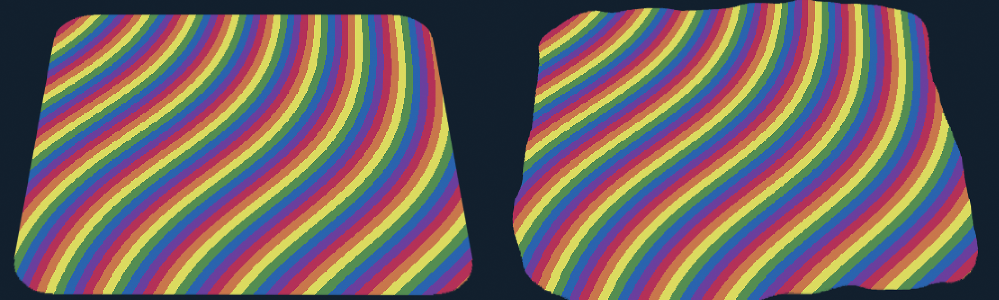
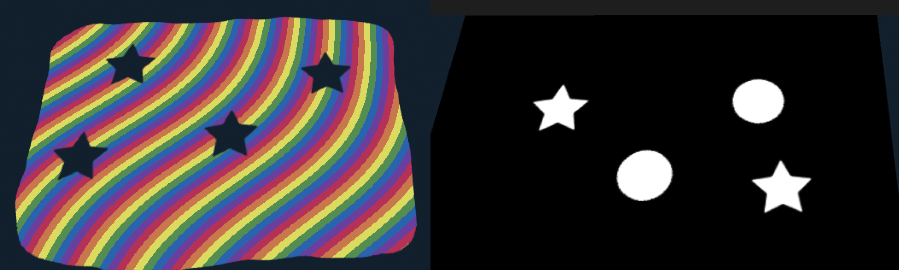
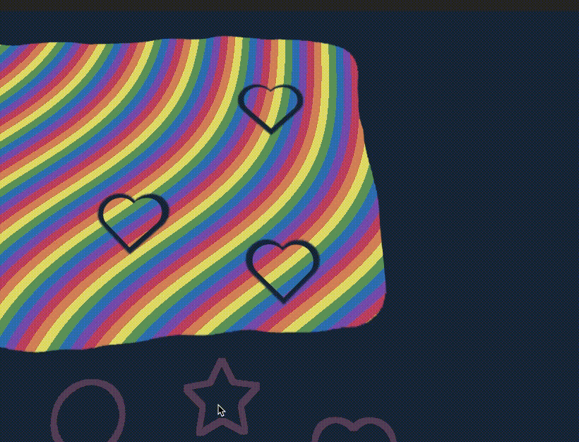

+++
date = '2021-01-26'
draft = false
title = 'Making Cookies'
subtitle = 'An experiment with shaders and draw textures'
featured_image = 'title.png'
tags = ["shaders", "procedual generation"]
+++



[View on itch.io <i class="aboutIcons fa-brands fa-itch-io fa-sm"></i>](https://alittleredpanda.itch.io/cookie-cutter)



This effect was created for a game jam revolved around making cookies. I think it was something to do with how we’re coping in lockdown. And well. I made a lot of cake.

I wanted cookies that could be cut from a base pattern, and retain said pattern. I don't know if anyone would notice, but it was cool.

Anyway. I started with a rounded rectangle and offset the UVs with a noise texture, making it a bit blobby. This was so I could do multiple rounds of cookies and each be unique.

With each drop of the cutter onto the dough area, I draw onto another texture, which is added to the blobby dough mask to make a combined mask. And that's how I cut out my cookies!

For added difficulty, I created the stripes. It's based on a [this tutorial](https://andreashackel.de/blog/2017-10-03-stripes-shader-1/) and tweaked to make a lovely rainbow.

Now the cookies.

The cookies are instantiated when you click, they use the same basic texture as the dough, and the tiling is set by dividing the dough’s tiling by the cookie scale.

The offset is a little hacky. It based on the scale of the cookie, the dough, and the position of the cookie in relation to the dough’s (0,0). The actual equation is in the script. It took quite a lot of tweaking and I'm not 100% sure how it works, but it does! And that's all I can wish for.

Anyway, my new repo, [Shader Sketchbook](https://github.com/viki-scull/ShaderSketchbook) can be found here. I'm going to stick everything like this in one big project, it's just a bit easier for me to manage, and it will never be particularly huge. It's just for me to be able to see all the things I've made and abandoned.