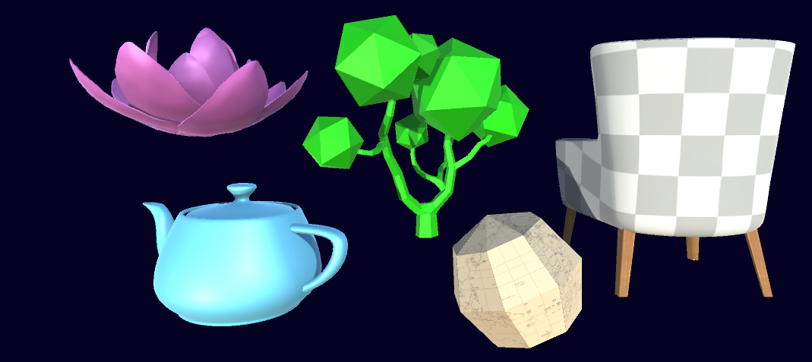
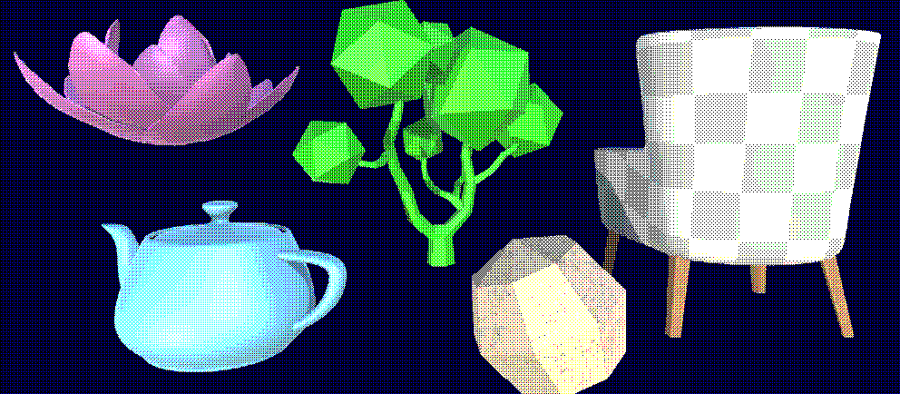
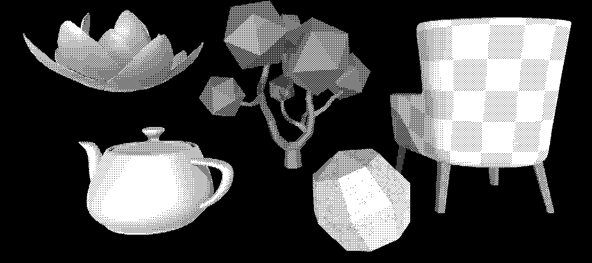
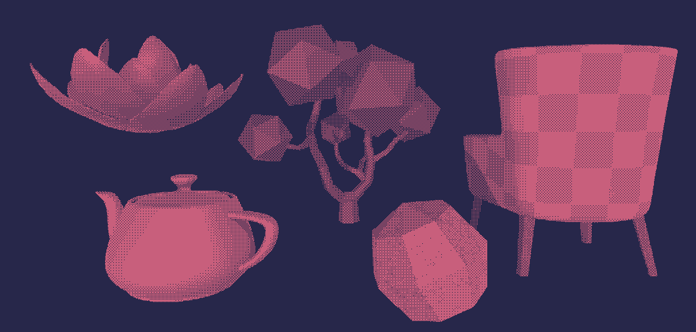
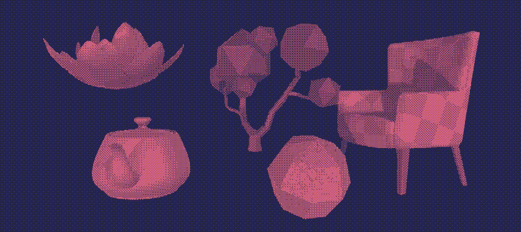

+++
date = '2021-04-11'
draft = false
title = 'Dithering Post Processing'
subtitle = 'A mini-game made for Ludum Dare 59: Signals'
featured_image = 'title.png'
tags = ["shaders"]

+++



[View on itch.io <i class="aboutIcons fa-brands fa-itch-io fa-sm"></i>](https://alittleredpanda.itch.io/dithering-postprocessing)



Dithering, specifically Ordered Dithering, is a way of displaying images, and was used back when computers only had about 16 colours to choose from, often they were completely monochromatic. Now it's more of a stylistic choice, and a similar effect was used in indie smash hit, Return of the Obra Dinn.

I wanted to create this effect in Unity, because it seems pretty cool and I want to learn more about post processing, and writing my own post processing scripts.

Initially I tried to posterise the view, like in Photoshop, and use each layer as a mask to show a different dithery texture, but decided that was just too messy. And it turns out that a dithering algorithm is available online, so it just made sense to use that and adapt it for what I need.

### Post Processing Script

This script just passes the view from the camera to the material specified, which will use our shader. By using ExecuteInEditMode we can see the effect without pressing play

~~~

using UnityEngine;
[ExecuteInEditMode]
public class PostProcess : MonoBehaviour {
    public Material material;
    void OnRenderImage (RenderTexture source, RenderTexture destination) {
        Graphics.Blit(source, destination, material);
    }
}

~~~

### Dithering Shader

Our shader only needs three properties, the MainTex, which comes from the camera, and the two colours to dither between

~~~
_MainTex("Texture", 2D) = "white" {}
_BackgroundCol("Background", color) = (0,0,0,0)
_ForegroundCol("Foreground", color) = (0,0,0,0)
~~~

Now at this point, if we just return the texture, we'll get our normal scene view

~~~
float4 frag(v2f_img input) : COLOR {
    float4 base = tex2D(_MainTex, input.uv);
    return base;
}
~~~

So we want to now pass that texture through the dithering algorithm. And that works by getting each of the rgb channels and seeing how close they are to 0 and passing back a 1 or 0 accordingly. You can read more about it [here](https://en.wikipedia.org/wiki/Ordered_dithering).

~~~
float4 frag(v2f_img input) : COLOR {
    uint matSize = 4;
    float4x4 mat = { 1, 8, 2,10,
                    12,4,14, 6,
                    3, 11, 1,9,
                    15, 7 ,13,5
                    };
    mat = mat / (matSize * matSize);
    int pxIndex = input.pos.x; //x index of texel
    int pyIndex = input.pos.y; //y index of texel
    float4 base = tex2D(_MainTex, input.uv);
    //get which index of dithering matrix texel corresponds to
    int mati = pxIndex % matSize;
    int matj = pyIndex % matSize;
    
    //quantization
    if (base.r > mat[mati][matj]) { base.r = 1; }
        else { base.r = 0; }
    if (base.g > mat[mati][matj]) { base.g = 1; }
        else { base.g = 0; }
    if (base.b > mat[mati][matj]) { base.b = 1; }
        else { base.b = 0; }
    return base;
}
~~~

Now this does dither the image. But I want to change this so that it only uses two colours.

So I added another line underneath base. This takes all three channels and adds them together, dividing by three to make it greyscale. It's not enough to just use one channel.

~~~
float c = (base.r + base.g + base.b)/3;
~~~

I can also delete all those if else statements at the end and replace with this one:

~~~
if (c > mat[mati][matj]) { c = 1; }
 else { c = 0; }
return c;
~~~

This will return a black and white dithered image!

And to add our colours in, we change the return line to make it a lerp. Now the black and white will be replaced with our two colours!

~~~
return lerp(_BackgroundCol, _ForegroundCol, c);
~~~

### Scaling the Dither

I felt that the pixels here were too small. I wanted more retro chunky pixels. Originally I had a RenderTexture attached to the camera, which I stuck on a canvas. I could control the size of the RenderTexture, making the resolution smaller and the pixels bigger. But my friend pointed out that I was just doing the same thing twice in different ways, and making two RenderTextures.

So instead I looked at editing the RenderTexture I had already created.

I added a scale variable to the PostProcess script, using a Range attribute so I don't accidentally divide by 0.

~~~
[Range(1,10)] public int scale;
~~~

Inside the OnRenderImage I set up a temporary RenderTexture, which we will blit to, and then blit from that to the destination. We set the dimensions to the scale. Create a temp texture and set the filtermode to Point. This ensures that the dithers stay crisp. Otherwise they're all blurry and just don't look good.

int width = source.width / scale; int height = source.height / scale; RenderTextureFormat format = source.format; RenderTexture r = RenderTexture.GetTemporary(width, height, 0, format); r.filterMode = FilterMode.Point;

I found that I add to edit the shader to make this look better too, so I set the scale of the shader based on this scale too. We'll assign this in a minute.

~~~
material.SetFloat("_Scale", 1f/scale);
~~~

Then we blit the source texture to our temporary one, then the temporary to the material and finally release it.

~~~
Graphics.Blit(source, r);
Graphics.Blit(r, destination, material);
RenderTexture.ReleaseTemporary(r);
~~~

Back in the shader script, add "_Scale" to the properties. And multiply the x and y by it.

~~~
int pxIndex = input.pos.x*_Scale; 
int pyIndex = input.pos.y*_Scale;
~~~

Now when I move the scale slider up and down the pixels get bigger and smaller, and I can set them to be as chunky as I want

This gif looks really bad, go check out the demo to see it work!

