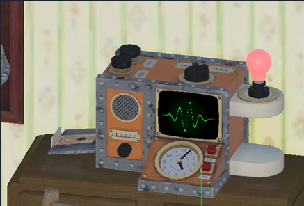
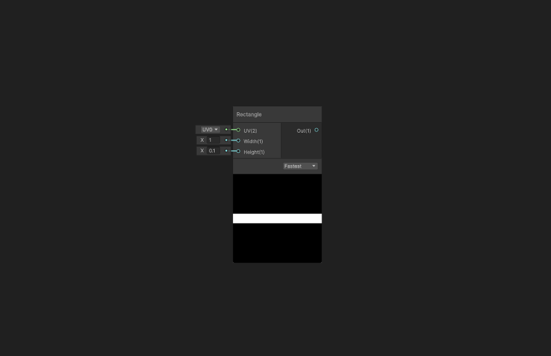
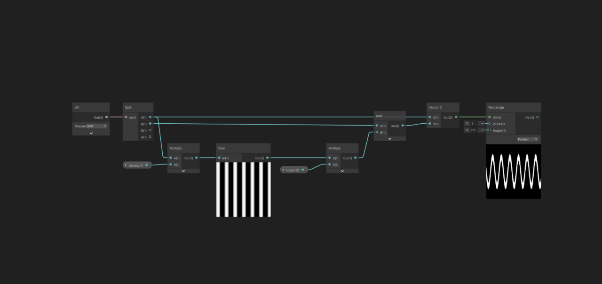
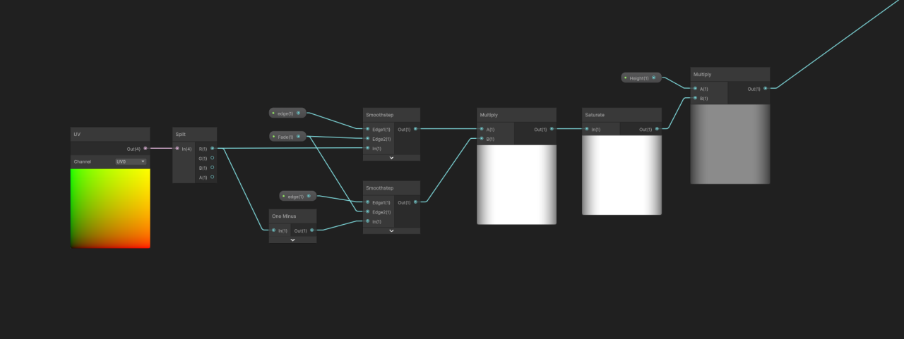
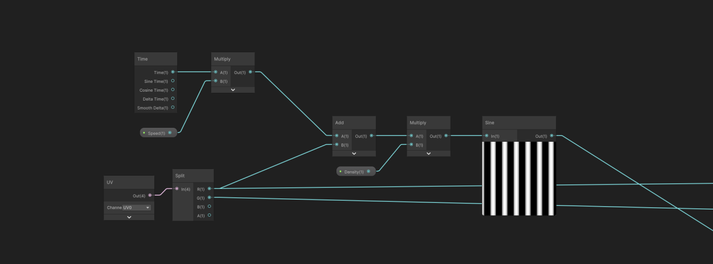
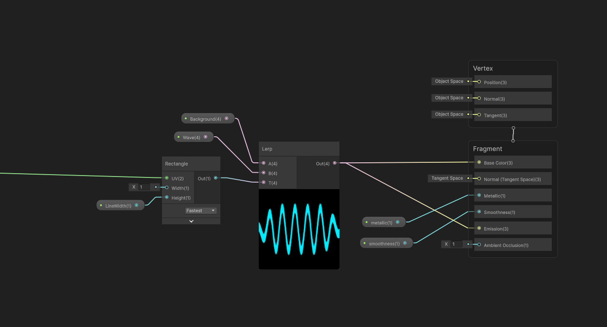
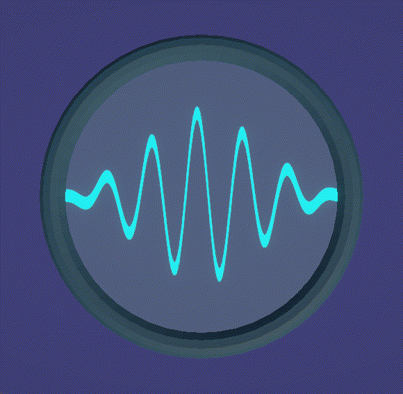

+++
date = '2024-05-13'
draft = false
title = 'Sound Waves'
subtitle = ''
featured_image = 'title.png'
tags = ["shaders"]

+++

It's been a good while since I've posted anything, and I've wanted to post some little effects from projects I have been working on, so this is the first one!

This is a little shader to create a sound wave in Unity, I used a similar one when I was working on the Wallace and Gromit project, [The Big Fix up](), a couple of years ago, as one of the characters talked to the player through radios, and we needed a visual representation of that!

Start off by adding a rectangle node, make sure it's thin and centred in the middle of the image.

Add a UV node. Put the X straight into the X of a Vector 2 node.

Create some stripes by multiplying the X axis (x10) and running it through a sine wave. Then multiply it by the height (0.2) then add this to the Y axis, and put it in the Y of the vector 2.

This gives us a sine wave.

Now grab another UV node, use the smoothstep node to fade this on each edge and multiply these together. Multiply this with the height node, and stick a saturate in there somewhere, to keep the value under one.

The result of this should be plugged into where the height was previously.

To animate the wave you can add a time node, and multiply it by speed (0.2), then add this to the X axis right at the start, before it's multiplied by the density.

Then you can use a lerp node to add colour, and hook the result into the BaseColor and Emission.

And you're done! You can animate the values with an animation or timeline, change colours, add more effects, anything you like!

